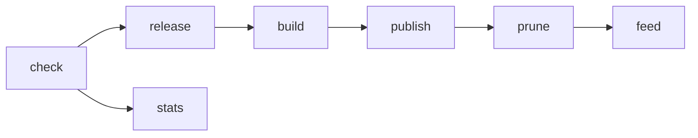

# Architecture

## Workflows

| Workflow | Builds | Release |
|---|---|---|
| `build.yml` | `ppe-nss` of openwrt-ppe-nss, six groups | `ppe-nss-*`, a new one per build |
| `build-ppe.yml` | `ppe-flow-offload`, every board of each subtarget, no NSS | `ppe-offload-test`, one prerelease updated in place |
| `lint.yml` | nothing | runs `actionlint`, `shellcheck` and `yamllint` on workflow and script changes |
| `custom.yml` | one image per `[build]` issue, from a release's ImageBuilder | `custom-<issue>-<run>` prerelease, deleted after seven days |
| `pages.yml` | nothing | republishes the image picker on `gh-pages` |

## The build.yml pipeline

| Job | Script | Does |
|---|---|---|
| `check` | `scripts/check-updates.sh` | Resolves the `ppe-nss` and `edma-nss` refs to commits. On a scheduled run it skips the build when the latest release already records both. Push and manual runs always build. |
| `stats` | `scripts/download-stats.sh` | Updates the download badge on the `stats` branch, including releases already pruned. |
| `release` | | Opens a draft release and writes its notes, including the source commits. |
| `build` | `scripts/prepare-build.sh` | One job per group. Checks out the source at the resolved commit, sets up feeds, patches, config and overlays, restores the caches, builds, and uploads the sysupgrade images, `sha256sums-<group>.txt`, `config-<group>.buildinfo`, the standalone ImageBuilder `imagebuilder-<group>.tar.zst` and the overlay `files-<group>.tar.gz` into the draft, and its target packages, `profiles.json` and manifests as a workflow artifact. |
| `publish` | | Publishes the draft once every job succeeded and marks it latest. If any job failed, it deletes the draft. |
| `prune` | `scripts/prune-releases.sh` | Keeps the newest `KEEP` releases of each prefix. |
| `feed` | `scripts/publish-site.sh` | Pushes each build's target packages (kernel, every kmod, signed `packages.adb`) to `gh-pages` at `<tag>/<group>/`, where the image's `997-kmod-feed` uci-defaults points, drops the feeds of releases that no longer exist, and writes the image picker (`site/`) with `releases.json` and `<tag>/boards.json`. |

## Image picker, custom images and updates

`gh-pages` is the image picker. `releases.json` lists the releases and
`<tag>/boards.json` holds, per board and group, the sysupgrade image, its
checksum and the image's package list. `pages.yml` republishes the picker
when `site/` changes.

A custom image is an issue from the `custom-build.yml` form, which the
picker fills in. `custom.yml` validates it with
`scripts/custom-request.py`, runs `make image` in the release's ImageBuilder
with the release's overlay files, attaches the image to a `custom-<issue>`
prerelease, answers on the issue and closes it. A daily run deletes custom
prereleases older than seven days.

Each image carries `/etc/ppe-release` (tag, group, site and repository).
`ppe-update` reads `releases.json` and `boards.json`, flashes the newest
image of its board and group, and installs the packages of `/etc/apk/world`
that the new image lacks again after the reboot.

## Design choices

- **All or nothing.** One release holds every board. A partial release
  would read as "this board is not supported" when only one group failed,
  so a failed job discards the whole draft.
- **Both firmware lines in one image.** The images carry NSS firmware 12.5
  and 11.4 and boot 12.5; `nss-wifi.general.firmware` picks 11.4 for
  802.11s mesh.
- **Groups by RAM.** The ath11k memory profile is fixed at build time for
  the whole image, so boards can only share a build when they share a RAM
  size.
- **Reproducible inputs.** `SOURCE_DATE_EPOCH` is the commit time of the
  checked-out source, with `TZ=UTC`, `LC_ALL=C` and fixed kbuild user and
  host. The images follow the branch tip, so each build pins a commit but
  the next one moves on.
- **Caches.** Verified source downloads and ccache are kept between runs
  (see [CUSTOMIZE.md](CUSTOMIZE.md#caches)). The build tree itself is never
  cached.
- **Scripts, not inline shell.** Logic lives in `scripts/` with
  `set -euo pipefail` and `scripts/lib/log.sh`, so it can be run and
  checked locally.

## Tests

`scripts/tests/prune-releases.test.sh` covers `prune-releases.sh`, which
deletes releases. `check-updates.sh` prints its decision and fails on bad
input. The rest drives `make` and is covered by the lint workflow.
